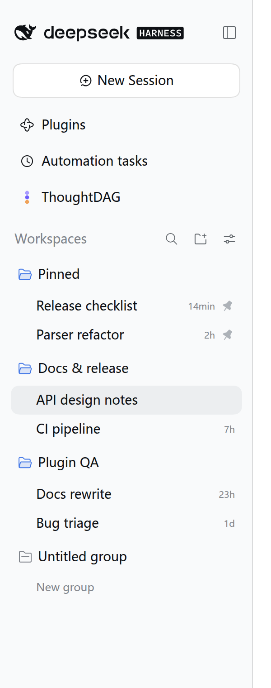
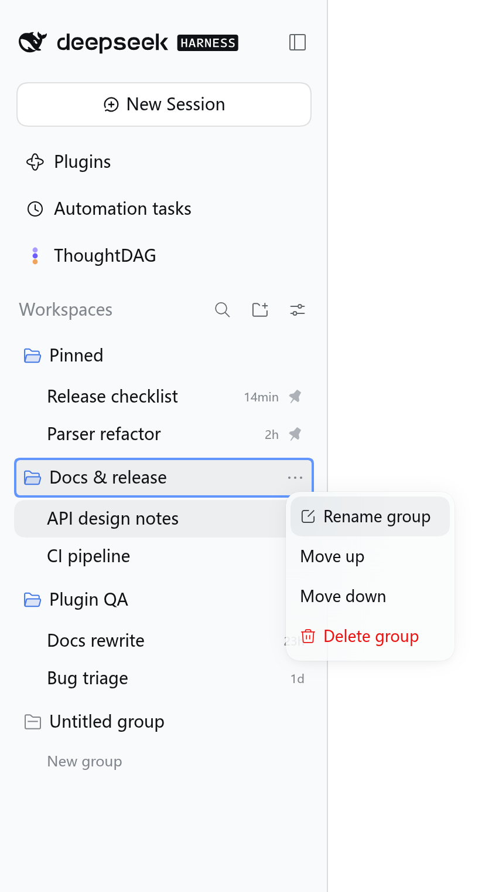
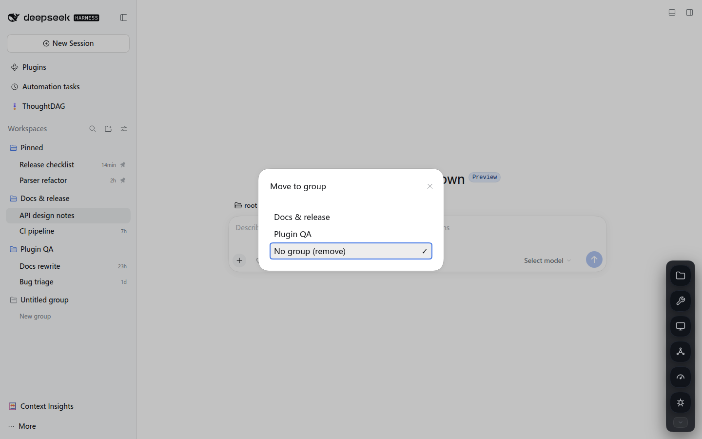

# dsh-session-groups · DSH 会话自定义分组

[](https://github.com/Xian-debu/dsh-session-groups/actions/workflows/ci.yml)
[](LICENSE)
[](package.json)
[](https://github.com/deepseek-ai)

给 [DeepSeek Harness](https://github.com/deepseek-ai)（下称 DSH）Web 会话侧栏加**第四种分组方式：自定义分组**。
自建分组、把会话拖进拖出、用键盘管理、按组折叠分页——全部是**显示层**的归类，不改动会话在磁盘上的真实顺序，也不上传任何数据。

> 非官方插件。本仓库 fork 自 DSH 自带包 `@deepseek-ai/dsh-client-ui-workspace`（MIT），只替换「会话浏览器」这一个 slot，其余部分原样保留。



*（截图使用示意会话名，非真实数据）*

## 功能

- **第四种分组模式**：会话侧栏「视图选项」菜单里多出 *Custom groups*，与官方的「按工作区 / 按时间 / 不分组」并列，随时可切回。
- **自建分组**：新建、改名（F2 / 双击 / 菜单）、上移下移、删除（二次确认）。
- **拖放归组**：把会话拖进分组头或组内即归组，拖回「未分组」区即解除；组内可拖拽排序。
- **行内「⋯」菜单**：*Move to group…* 弹窗选组，*Remove from custom group* 一键移出；菜单项按当前归组状态自动显隐。
- **置顶独立区**：置顶会话自动进入 *Pinned* 区，优先级高于归组，不重复出现、不可拖入分组。
- **折叠 / 分页**：分组头可折叠；成员多时按组水印分页（*Show N more sessions* / *Show less*）。
- **键盘可达**：分组头可 Tab 聚焦，Enter/空格折叠，F2 改名，Shift+F10 打开菜单，方向键/Home/End 在菜单内导航，Esc 取消。
- **与官方能力协同**：搜索、归档筛选、置顶、手动排序、locale（zh/en）、aria 全部保留。





## 与其它开源项目的关系

| 项目 | 关系 |
| --- | --- |
| `@deepseek-ai/dsh-client-ui-workspace` | **上游**。本仓库 vendor 其 `lib/client.js`（232,668 B / 5,354 行），以 7 个 patch 叠加功能后构建产物。MIT 许可，保留原署名。 |
| DeepSeek Harness | **宿主**。只通过 profile 的 `dsh.profile.bundles` 注入本包，不修改 DSH 安装目录里的任何文件。 |
| 本机其它 DSH 插件（dsh-ops / dsh-skill-hub / dsh-proxy-hub 等） | **互不依赖**。它们各自是独立包；本插件占用 `sidebar.workspaces` 这个 single slot，与它们注册的 slot 不冲突。 |

## 环境要求

| 项 | 要求 | 说明 |
| --- | --- | --- |
| DSH | `0.2.1-rc.2`（已验证） | 上游包结构随版本变动，换版本需重新 vendor + build + verify，见 [docs/13](docs/13-environments.md#133-各环境要点与难度) |
| Node.js | `>= 22` | 构建脚本与插件运行环境 |
| 平台 | Linux / macOS / WSL2 | Windows 原生可用但未实测（见 [docs/13](docs/13-environments.md)） |
| 浏览器 | 任一现代浏览器 | e2e 冒烟需要本机 Chrome/Chromium |

## 快速开始

```bash
# 1) 取仓库
git clone https://github.com/Xian-debu/dsh-session-groups.git
cd dsh-session-groups

# 2) 构建产物（pristine + patches → lib/client.js）并自检
node scripts/build.mjs
node scripts/verify.mjs

# 3) 装进 profile（默认 --profile web）
node scripts/install.mjs --dry-run    # 先看它要改什么
node scripts/install.mjs              # 真正写入（自动备份 package.json）

# 4) 重启 DSH Web 进程（插件集合只在进程启动时装载）
#    systemd: sudo systemctl restart dsh-web
#    前台:    Ctrl+C 后重新 dsh web
```

重启后打开会话侧栏 → 「视图选项」→ **Custom groups**。新建第一个分组即可。

## 安装方式

### 方式 A：link 安装（推荐，开发与自用）

`scripts/install.mjs` 做的事（幂等，可重复执行）：

1. 在 profile 的 `package.json` 里登记 `dependencies["dsh-session-groups"] = "link:<仓库绝对路径>"`；
2. 往 `dsh.profile.bundles` 追加包名；
3. 在 `<profile>/node_modules/` 下建相对软链（Windows 用 junction）；
4. 写文件前备份为 `package.json.bak.<UTC 时间戳>`。

```bash
node scripts/install.mjs --check        # 只检查，0=正常 / 1=异常
node scripts/install.mjs --remove       # 卸载（还原依赖与 bundles 登记，删软链）
node scripts/install.mjs --json         # 机器可读输出
```

源码目录即生效目录：改完 `lib/client.js` 刷新页面即可，无需复制。

### 方式 B：手动编辑 profile

不想跑脚本时，等价的手工步骤：

```jsonc
// <DSH_HOME>/profiles/web/package.json
{
  "dependencies": { "dsh-session-groups": "link:/absolute/path/to/dsh-session-groups" },
  "dsh": { "profile": { "bundles": [ /* …原有项…, "dsh-session-groups" */ ] } }
}
```

```bash
ln -sfn /absolute/path/to/dsh-session-groups <DSH_HOME>/profiles/web/node_modules/dsh-session-groups
```

### 方式 C：`dsh plugin add`（不推荐）

历史上有 `ERR_PNPM_NO_MATCHING_VERSION` 等解析问题（见 [docs/10](docs/10-finding-duplicate-session-id-menu.md)），
且它不保证 link 语义。除非你的 profile 依赖树干净，否则优先用方式 A。

## 用法

| 操作 | 方式 |
| --- | --- |
| 切到自定义分组 | 侧栏「视图选项」→ *Custom groups* |
| 新建分组 | 列表底部 *New group*，或分组菜单里的新建项 |
| 会话归组 | 拖到分组头/组内；或行内「⋯」→ *Move to group…* → 选组 |
| 解除归组 | 拖回 *Untitled group*；或「⋯」→ *Remove from custom group* |
| 改名 | 双击分组头 / F2 / 分组菜单 *Rename group* |
| 调序 | 分组菜单 *Move up* / *Move down* |
| 删除 | 分组菜单 *Delete group* → 二次确认（组内会话回到未分组，不会删会话） |
| 折叠 | 点分组头，或聚焦后 Enter / 空格 |
| 看更多 | 组内超过水印时点 *Show N more sessions* |

### 键盘

| 键 | 作用 |
| --- | --- |
| `Tab` / `Shift+Tab` | 在分组头与行之间移动焦点 |
| `Enter` / `Space` | 折叠 / 展开当前分组 |
| `F2` | 重命名当前分组（仅真实分组） |
| `Shift+F10`（或菜单键） | 打开分组菜单并聚焦第一项 |
| `↑` / `↓` / `Home` / `End` | 菜单内导航 |
| `Enter` | 执行菜单项 |
| `Esc` | 关闭菜单 / 取消改名 / 取消删除确认 |

## 数据与隐私

- 全部状态存在浏览器 `localStorage`，键名 **`dsh.sessionGroups.v1`**，按 **origin** 隔离（换端口/域名＝另一份数据）。
- 结构：`{ version, groups: [{id,name}], groupOrder, assignments: {sessionId: groupId}, collapsed }`。
- 不联网、无遥测、不回传任何会话内容；分组只是「会话 id → 组 id」的映射。
- 导出/备份（浏览器控制台）：

```js
copy(localStorage.getItem("dsh.sessionGroups.v1"))        // 备份
localStorage.setItem("dsh.sessionGroups.v1", "<粘贴>")     // 还原后刷新
```

- 卸载本插件不会删数据；清空 localStorage 或删键即彻底清除。

## 验证

```bash
node scripts/build.mjs    # pristine + patches → lib/client.js，并校验逐字节一致
node scripts/verify.mjs   # 11 项检查：上游 sha、patch 覆盖、注入声明、id 唯一、locale 键等
node scripts/e2e.mjs --url "http://127.0.0.1:3099/?token=<token>"   # 端到端冒烟（自起临时 chrome，S1–S9）
```

CI（GitHub Actions）跑两件事：`build` 后 `git diff --exit-code -- lib/client.js`（保证产物与 patch 一致），以及 `node --check` 全部 JS。
本地无 DSH 安装时 `verify` 自动降级为「快照自校验」（V1d），仍能验证 patch 管线的完整性。

## 已知问题

完整清单见 [docs/14-known-issues.md](docs/14-known-issues.md)。最常见的几条：

1. **强绑定上游版本**：升级 DSH 后必须重新 vendor + build；否则 slot/注入可能对不上。
2. **全局单会话浏览器**：本插件替换的是整个会话侧栏（`sidebar.workspaces` 是 single slot），与别的「会话浏览器类」插件互斥。
3. **数据在 localStorage**：换端口、换 profile、换浏览器都看不到同一份分组；无跨设备同步。
4. **插件集合只在进程启动装载**：装了/卸了必须重启 DSH Web 进程，热插拔无效。
5. **行内「⋯」而非右键菜单**：宿主没有真正的 `contextmenu`，归组入口在行内按钮。
6. **删除分组不可撤销**：组内会话会回到未分组，但组定义本身没有 undo。

## 部署到其它环境

不同环境的改造量与坑位差异很大，难度与步骤见 [docs/13-environments.md](docs/13-environments.md)：

| 环境 | 难度 | 关键点 |
| --- | --- | --- |
| Linux + systemd（作者环境） | ★ | 照 README 走即可 |
| macOS 本机 | ★★ | 服务由 launchd/前台启动，重启方式不同 |
| Windows 原生 | ★★★ | 软链退化为 junction；路径/权限需注意（未实测） |
| 容器 / 只读根文件系统 | ★★★ | 必须把 `DSH_HOME` 挂成卷，否则重启即丢 |
| 反向代理 / 多用户共享 | ★★★★ | localStorage 按 origin，多用户会共享同一份分组数据 |

## 升级 / 卸载 / 回滚

- **升级本插件**：`git pull` → `node scripts/build.mjs` → `node scripts/verify.mjs` → 重启 DSH。
- **升级 DSH 后**：`node scripts/vendor.mjs`（重新取上游）→ 逐个 patch 重基 → `build`/`verify`/`e2e`。
- **临时禁用**：从 profile 的 `bundles` 里注释掉包名 → 重启（软链可留着）。
- **彻底卸载**：`node scripts/install.mjs --remove` → 重启。
- **回退到官方侧栏**：`--remove` 后重启即可，数据仍在 localStorage 里（再装回来即恢复）。
- 详细的分级回滚（单文件快照 / 整包快照 / 数据清理 / 故障排查）见 [docs/12-release-rollback.md](docs/12-release-rollback.md)。

## 仓库结构

```
lib/            build 产物：client.js（注入前端）、index.js（服务端空壳）
vendor/         上游快照 client.pristine.js + upstream.json（sha256/版本锚点）
patches/        0001…0007 增量补丁（pristine 之上依次叠加）
scripts/        vendor / build / verify / install / e2e
src/            插件入口源码
docs/           01–14 设计、验收、发布、环境、已知问题
docs/images/    README 截图
```

### 开发流程（改代码必读）

1. 改 `lib/client.js`（手改，产物即源）；
2. **先生成 patch**：`diff -u --label a/lib/client.js --label b/lib/client.js <上一阶段产物> lib/client.js > patches/000N-xxx.patch`；
3. 再 `node scripts/build.mjs`（它会用 pristine+patches **覆盖** `lib/client.js`）；
4. `node scripts/verify.mjs` 必须 PASS，且 build 结果与手改逐字节一致；
5. 探针实例（独立端口 + headless Chrome）验证 UI，0 console error 才算过；
6. 更新文档 → 独立提交，提交信息一行中文：`NN-stage: 做了什么`。

> 顺序反了（先 build 再出 patch）会把你的手改抹掉。

## 维护者发布流程（需要 GitHub token）

代码本身不需要任何凭证；只有**推送与发版**需要 GitHub 身份。

```bash
gh auth status                 # 确认已登录，至少需要 repo 权限（发版加 workflow）
gh auth login                  # 交互登录（推荐 device flow）
gh repo create Xian-debu/dsh-session-groups --public --source . --push
```

- 本机 `gh` 已登录 `Xian-debu`，scopes：`repo`, `read:org`, `workflow`。
- `GITHUB_TOKEN` 环境变量若存在但已过期，会覆盖 `gh` 的登录态并返回 401——排查时先 `gh auth status`，必要时 `unset GITHUB_TOKEN`。
- 发版：`git tag v1.0.0 && git push --tags`，再 `gh release create v1.0.0 --generate-notes`。
- 不发布到 npm（本插件靠 profile link 安装；npm 上同名包非本仓库所有）。

## 文档索引

| 文档 | 内容 |
| --- | --- |
| [docs/01-purpose.md](docs/01-purpose.md) | 目的、需求原文、目标与非目标、验收标准 |
| [docs/02-constraints.md](docs/02-constraints.md) | 技术/环境/工程/安全硬约束 |
| [docs/03-architecture.md](docs/03-architecture.md) | 插件加载链路、上游包结构、数据流与行号锚点 |
| [docs/04-extension-points.md](docs/04-extension-points.md) | slot/hole 清单、可注入内容、拖拽复用点、patch 层能力 |
| [docs/05-options.md](docs/05-options.md) | 四种实现路线对比与推荐 |
| [docs/06-design-draft.md](docs/06-design-draft.md) | 设计草案与裁决记录 |
| [docs/07-roadmap.md](docs/07-roadmap.md) | 阶段拆分、提交点、逐阶段验收记录 |
| [docs/08-conventions.md](docs/08-conventions.md) | vendor 升级、构建、安装、回滚、提交规范 |
| [docs/09-risks.md](docs/09-risks.md) | 风险与缓解 |
| [docs/10-finding-duplicate-session-id-menu.md](docs/10-finding-duplicate-session-id-menu.md) | 「复制 Session ID」重复项定性 |
| [docs/11-maintenance-log.md](docs/11-maintenance-log.md) | 维护日志 M1–M11 |
| [docs/12-release-rollback.md](docs/12-release-rollback.md) | 发布与回滚手册 |
| [docs/13-environments.md](docs/13-environments.md) | 各环境部署指南与难度 |
| [docs/14-known-issues.md](docs/14-known-issues.md) | 已知问题清单 |

## 后续改进

- 分组导入/导出 UI（现在靠 localStorage 手抄）；
- 分组颜色与图标、组内自由排序；
- 跟随 DSH 上游自动 rebase 的 helper（现在靠人工 patch）；
- e2e 扩到「排序 / 归档 / 搜索」交叉场景，接入 CI（需 chrome runner）。

## 许可与致谢

- MIT。见 [LICENSE](LICENSE) 与 [NOTICE](NOTICE)。
- 上游版权归 DeepSeek；本仓库对 `@deepseek-ai/dsh-client-ui-workspace` 的派生部分保留原许可与署名。
- 感谢 DSH 团队提供的可扩展插件架构。
